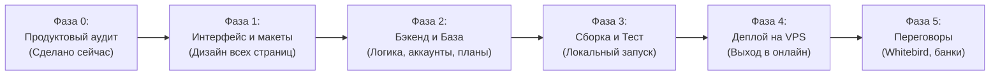

# Генеральный план разработки стартапа AutoInvest BY (Master Roadmap)

## 1. Философия и принципы работы над проектом

1. **Последовательность (Никакой спешки):** Не пишем код, пока до винтика не согласованы сценарии и архитектура.
2. **Полноценный боевой продукт (No Toy Mockups):** Создается не картинка в Figma с двумя кнопками, а реальный веб-сервис с рабочей базой данных, аутентификацией, сессиями и защитой.
3. **Бережливый запуск (Lean Bootstrapping):** Разработка ведется без раздутых корпоративных бюджетов, с нулевыми лишними затратами, с использованием надежного бесплатного open-source стека и недорогого хостинга ($3–5/мес).
4. **Разделение ролей:**
   * **Руслан (Founder / Product Owner):** Видение продукта, контроль логики и удобства (UX), тестирование гипотез, общение с партнерами.
   * **Напарник (BizDev / Operations / Marketing):** Исследование рынка, проведение опросов целевой аудитории (студенты, молодые специалисты), составление базы контактов, документация.
   * **Antigravity IDE (CTO / Lead Architect & Developer):** Проектирование архитектуры, написание 100% серверного и клиентского кода, настройка базы данных, подготовка скриптов автозапуска и развертывания на сервере.

---

## 2. Поэтапный план реализации (6 фаз)

---

### ФАЗА 0: Предпроектный анализ и проектирование (ТЕКУЩИЙ ЭТАП)
* [x] Глубокий бенчмаркинг мировых лидеров (Acorns, Binance Auto-Invest, Т-Банк) и специфики Республики Беларусь.
* [x] Выбор бизнес-модели: отказ от сложного и рискованного считывания банковских чеков в пользу **регулярного рекуррентного автоинвестирования (DCA)**.
* [x] Составление детальной карты функционала: 5 ключевых разделов (Dashboard, Планы, Калькулятор, История, Профиль).
* [x] Проектирование структуры данных (Users, PaymentProfiles, InvestmentPlans, Allocations, Transactions).
* [x] Создание единого проектного репозитория и базы знаний.

---

### ФАЗА 1: Визуальное проектирование и прототипирование экранов
* [ ] Разработка дизайн-системы (цвета, шрифты, компоненты кнопок, карточек, риск-бейджей).
* [ ] Верстка всех 5 экранов в виде интерактивного HTML/CSS прототипа.
* [ ] Проверка мобильной адаптивности: приложение должно безупречно смотреться на экранах смартфонов (iPhone SE, iPhone 14/15, Android).
* [ ] Проведение первичного тестирования удобства (UX-тест) с напарником и 5–10 знакомыми: все ли кнопки понятны, не пугают ли формулировки.

---

### ФАЗА 2: Серверная разработка и база данных
* [ ] Инициализация бэкенд-модуля на языке Go.
* [ ] Создание локальной базы данных SQLite (хранение учетных записей, планов, транзакций).
* [ ] Реализация модуля авторизации:
  * Регистрация с валидацией email и пароля;
  * Безопасное хэширование паролей (bcrypt);
  * Управление пользовательскими сессиями (cookies / JWT).
* [ ] Реализация CRUD-интерфейса планов инвестирования:
  * Создание плана (выбор периодичности, суммы, стратегии);
  * Редактирование, пауза в 1 клик, возобновление и удаление.
* [ ] Разработка движка DCA-робота (Фоновый воркер):
  * Симуляция планировщика (Cron), который проверяет наступление времени автопокупки, считывает текущий курс актива и фиксирует исполненную транзакцию.

---

### ФАЗА 3: Сборка цельного приложения и локальное тестирование
* [ ] Интеграция фронтенда и бэкенда в единый бинарный сервис (Go embed — статические файлы вшиты прямо внутрь исполняемого файла).
* [ ] Создание скрипта быстрого запуска для Руслана (`run.bat`):
  * Двойной клик -> сервер стартует -> в браузере автоматически открывается `http://localhost:8080`.
* [ ] Сквозное тестирование пользовательских сценариев:
  * Сценарий А: Регистрация нового аккаунта -> запуск консервативного плана на 10 BYN/неделю -> проверка лога транзакций;
  * Сценарий Б: Выбор высокорискового плана -> проверка появления риск-предупреждения;
  * Сценарий В: Изменение параметров плана и проверка пересчета доходности в калькуляторе.

---

### ФАЗА 4: Развертывание на реальном VPS сервере (Выход в Интернет)
* [ ] Выбор и покупка недорогого виртуального сервера (VPS на Ubuntu Linux):
  * Характеристики: 1–2 vCPU, 2 ГБ RAM, 20–30 ГБ SSD.
  * Стоимость: ~$3–5/месяц (Timeweb, Beget или белорусский Hoster.by).
* [ ] Упаковка приложения в легкий Docker-контейнер.
* [ ] Настройка веб-сервера Caddy для автоматического получения бесплатного SSL-сертификата (HTTPS).
* [ ] Привязка домена (или бесплатного технического поддомена).
* [ ] Результат: сайт доступен круглосуточно в онлайне для любого пользователя по всему миру.

---

### ФАЗА 5: Тестирование на фокус-группе и выход на партнеров
* [ ] Привлечение первой фокус-группы (50–100 студентов БГУИР и молодежи):
  * Сбор реальной аналитики использования сервиса.
* [ ] Подготовка короткого скринкаст-видео (60–90 секунд) с демонстрацией работы веб-сервиса на смартфоне.
* [ ] Подготовка презентации для партнеров (Pitch Deck на 7 слайдов).
* [ ] Адресный выход на лиц, принимающих решения (LPR) в ЗАО «Уайт Бёрд» и финтех-подразделениях белорусских банков.
