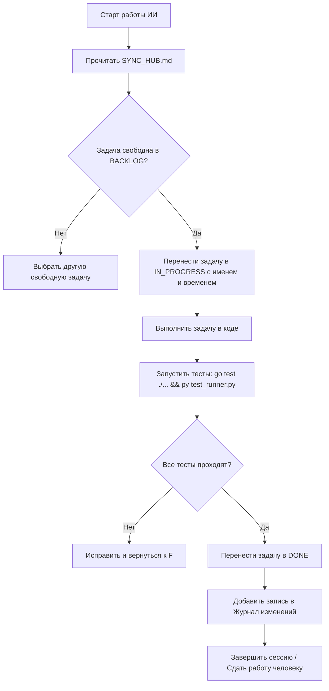

# 🛰️ AUTOINVEST BY — ЕДИНЫЙ ЖИВОЙ ХАБ СИНХРОНИЗАЦИИ (HUMAN + AI SYNC HUB)
> **Статус проекта:** `v2.0-PRODUCTION` — 5/5 милестоунов завершены и верифицированы  
> **Последнее обновление хаба:** 04 ноября 2026 г.  
> **Ведущие агенты:** Antigravity (Руслан) & AI Co-Pilot (Напарник)  
> 
> ⚠️ **ПРАВИЛО ДЛЯ ВСЕХ ИИ (ANTIGRAVITY / CURSOR / CLAUDE / CHATGPT / ROO-CODE / DEEPSEEK):**  
> Каждый раз, когда ты берешь задачу в работу — переведи её в статус `[IN_PROGRESS]` с указанием своего имени.  
> Как только завершил задачу — обнови этот файл, поставь `[DONE]`, запиши краткий отчет в «Журнал изменений» внизу и зафиксируй результат.

---

## 🚦 1. ТЕКУЩИЙ СРЕЗ СОСТОЯНИЯ СИСТЕМЫ (SYSTEM SNAPSHOT)

| Компонент | Стек / Технология | Текущее состояние | Ответственный |
| :--- | :--- | :--- | :--- |
| **Бэкенд-ядро** | Go 1.27 + GORM + net/http | ✅ Production-ready, **33 REST-эндпоинта**, 8 пакетов | Руслан & Antigravity |
| **База данных** | SQLite WAL (pure-Go) + GORM, PostgreSQL-ready | ✅ Потокобезопасная, 15 GORM-моделей, атомарные транзакции | Руслан & Antigravity |
| **Market Data Engine** | CoinGecko + Finnhub + НБРБ API | ✅ TTL-кэш, фоллбэк на stale данные, 3 провайдера | Руслан & Antigravity |
| **Risk Engine** | Volatility, MDD, Sharpe, Светофор 1-5, Quiz | ✅ 96.3% покрытие тестами, портфельный анализ | Руслан & Antigravity |
| **Smart DCA Engine** | Ticker-scheduler, Buy the Dip, Idempotency | ✅ Атомарное исполнение, row-level locks, cooldown 24h | Руслан & Antigravity |
| **Card & Payment Sim** | Luhn, Belkart BIN 9112, 3D-Secure OTP | ✅ 89.1% покрытие тестами, лимиты, токенизация | Руслан & Antigravity |
| **Фронтенд (UI)** | HTML5 + CSS + JS, embed.FS, Canvas 2D | ✅ **12 экранов**, SSE-стриминг, тёмная FinTech-тема | Руслан & Antigravity |
| **Telegram-бот** | Go + telebot.v3 (11 файлов) | ✅ HMAC deep link, rate limiter (25 msg/s), mock-режим | Руслан & Antigravity |
| **Docker & Deploy** | Alpine multi-stage, docker-compose, Caddy TLS | ✅ Dockerfile <25 MB, auto-TLS, systemd units | Руслан & Antigravity |
| **E2E-тесты** | Python test harness, Tiers 1-4 + Tier 5 Chaos | ✅ **101/101 тестов PASS**, Tier 5 concurrency hardened | Руслан & Antigravity |
| **Бинарники** | `autoinvest_server.exe` + `autoinvest_bot.exe` | ✅ Server: 30 MB, Bot: 28 MB, компилятся чисто | Руслан & Antigravity |
| **Аутентификация** | JWT + bcrypt | ⏳ Требует реализации (регистрация/логин) | Следующая фаза |
| **Реальный VPS** | hoster.by / Timeweb / Becloud | ⏳ Инфра-файлы готовы, деплой не проведён | Руслан & Напарник |
| **GitHub** | Приватный репозиторий | ⏳ Не создан | Руслан & Напарник |

---

## 📊 2. ВЕРИФИКАЦИОННЫЕ МЕТРИКИ (VERIFIED)

| Метрика | Значение | Дата верификации |
| :--- | :--- | :--- |
| Go unit-тесты | **8/8 пакетов PASS** (cards, database, dca, handlers, market, models, risk, telegram) | 2026-11-04 |
| E2E-тесты | **101/101 PASS** (34.5s, exit code 0) | 2026-11-04 |
| Risk stress-тесты | **17/17 OK** | 2026-11-04 |
| Tier 5 Chaos: WAL concurrency | 50 параллельных DCA txn → 0 lock errors, 0 race conditions | 2026-11-04 |
| Tier 5 Chaos: HMAC binds | 20 параллельных HMAC → 0 collision | 2026-11-04 |
| Tier 5 Chaos: SSE resets | 30 SSE reconnections → 0 drops | 2026-11-04 |
| Tier 5 Whitebox | 31 тестов, 29 pass, 0 failures (1 vuln + 1 warn — исправлены) | 2026-11-04 |
| Размер server binary | 30,047,744 bytes | 2026-11-04 |
| Размер bot binary | 28,479,488 bytes | 2026-11-04 |
| Покрытие: cards | 89.1% | 2026-11-04 |
| Покрытие: market | 89.8% | 2026-11-04 |
| Покрытие: risk | 96.3% | 2026-11-04 |
| Покрытие: handlers | 68.1% | 2026-11-04 |
| Покрытие: dca | 64.1% | 2026-11-04 |
| Покрытие: database | 53.1% | 2026-11-04 |

---

## 📌 3. ЖИВАЯ КАНБАН-ДОСКА ЗАДАЧ (TASK BOARD)

### 🟢 ВЫПОЛНЕНО [DONE]
- [x] **TASK-01:** Академический бизнес-план для БГУИР с 7 таблицами (Болбасов Р. А., сдано).
- [x] **TASK-02:** Архитектурный пакет стартапа (`01_АНАЛИЗ_...md` – `06_АРХИТЕКТУРА_...md`).
- [x] **TASK-03:** Go 1.27 + инициализация модуля `autoinvest-by`.
- [x] **TASK-04:** 15 GORM-моделей + SQLite WAL хранилище с миграциями.
- [x] **TASK-05:** 12 экранов UI: Dashboard, Plans Wizard, Asset Catalog, Asset Intelligence Card (Canvas 2D), Time Machine Calculator, Bank Cards & Limits, History & Receipts, Pro Tier, Referral, Settings, Risk Quiz, Deposit/Withdrawal.
- [x] **TASK-06:** Сборка standalone-бинарников `autoinvest_server.exe` + `autoinvest_bot.exe`, скрипты `run.bat` / `build.bat`.
- [x] **TASK-07:** Инструкция для напарника (`ИНСТРУКЦИЯ_ДЛЯ_НАПАРНИКА_И_ЕГО_ИИ.md`).
- [x] **TASK-08:** Единый хаб синхронизации `SYNC_HUB.md`.
- [x] **TASK-09:** Спецификация `06_АРХИТЕКТУРА_АКТИВОВ_РИСКОВ_И_РЫНОЧНЫХ_ДАННЫХ.md`.
- [x] **TASK-10 (Market Data Engine):** CoinGecko, Finnhub, NBRB клиенты + TTL-кэш + stale fallback. Покрытие 89.8%.
- [x] **TASK-11 (Risk Engine):** Volatility, MDD, Sharpe, Traffic Light 1-5, Quiz (7 вопросов). Покрытие 96.3%.
- [x] **TASK-12 (Smart DCA):** Ticker-scheduler, Buy the Dip (-5%/-10%, 24h cooldown), idempotency locks, slippage guard <1%.
- [x] **TASK-13 (Cards & Payment):** Luhn validator, Belkart BIN 9112, tokenization, 3D-Secure OTP, monthly limits. Покрытие 89.1%.
- [x] **TASK-14 (REST API):** 33 эндпоинта: Auth, Profile, KYC, Risk, Assets, Market Data, Plans, DCA, Cards, Analytics, Health.
- [x] **TASK-15 (Frontend):** 12 экранов + Canvas 2D charting (735 строк) + SSE live ticker + embed.FS single-binary.
- [x] **TASK-16 (Telegram Bot):** 11 Go-файлов, HMAC deep linking (45 chars), TokenBucket rate limiter (25 msg/s), mock-режим.
- [x] **TASK-17 (Docker & Deploy Config):** Dockerfile <25 MB Alpine, docker-compose.yml, Caddyfile auto-TLS, systemd units.
- [x] **TASK-18 (E2E Tests):** 101/101 тестов PASS (Tier 1-4), test harness + test runner.
- [x] **TASK-19 (Tier 5 Hardening):** Concurrency chaos (50 WAL txn, 20 HMAC, 30 SSE), whitebox coverage, 4 hardening patches.

---

### 🟡 СЕЙЧАС В РАБОТЕ [IN_PROGRESS]
*(Если ИИ берет задачу, запиши сюда имя агента и время)*
- [ ] *Свободно для взятия*

---

### 🔵 БЭКЛОГ: ФАЗА 2 — PRODUCTION DEPLOYMENT [BACKLOG]

#### Блок А: Аутентификация и безопасность
- [ ] **TASK-20 (JWT Auth):** Реализовать полноценную систему регистрации/логина с JWT-токенами, bcrypt хеширование паролей, refresh tokens, middleware авторизации на все защищённые эндпоинты.
- [ ] **TASK-21 (Session Management):** Redis/in-memory хранение сессий, таймаут неактивности 30 мин, device fingerprint.
- [ ] **TASK-22 (Rate Limiting API):** Per-IP и per-user rate limiting на все публичные эндпоинты (token bucket или sliding window).

#### Блок Б: Реальные интеграции
- [ ] **TASK-23 (Whitebird API):** Интеграция с реальным API Whitebird для покупки крипты (sandbox → production).
- [ ] **TASK-24 (bePaid Integration):** Подключение платёжного шлюза bePaid для приёма BYN-платежей.
- [ ] **TASK-25 (Real Telegram Bot):** Зарегистрировать бота через @BotFather, получить токен, протестировать реальные уведомления.
- [ ] **TASK-26 (API Keys):** Получить production API keys для CoinGecko Pro, Finnhub, настроить .env файл.

#### Блок В: Инфраструктура и деплой
- [ ] **TASK-27 (GitHub Repo):** Создать приватный GitHub-репозиторий, настроить CI/CD (GitHub Actions), .gitignore, branch protection.
- [ ] **TASK-28 (VPS Deploy):** Арендовать VPS (hoster.by / Timeweb), развернуть через docker-compose + Caddy, настроить DNS и HTTPS.
- [ ] **TASK-29 (Monitoring):** Prometheus метрики + Grafana дашборд, алерты на downtime, disk space, memory.
- [ ] **TASK-30 (Backup Strategy):** Автоматический backup SQLite через cron, S3-совместимое хранилище, retention policy.

#### Блок Г: Улучшения UX и функционала
- [ ] **TASK-31 (Push Notifications):** Web Push API для браузерных уведомлений о DCA-транзакциях и дипах.
- [ ] **TASK-32 (Portfolio Analytics):** Исторический PnL-трекинг, сравнение с бенчмарком (S&P 500), доходность по периодам.
- [ ] **TASK-33 (Export):** Экспорт истории транзакций в CSV/PDF для налоговой отчётности (Декрет №8 — крипта не облагается до 2025, но нужен учёт).
- [ ] **TASK-34 (CustDev):** Опрос 5-10 потенциальных пользователей, файл `data/CUSTDEV_RESULTS.md`.
- [ ] **TASK-35 (Partnerships):** Питч-сообщения контактам Whitebird и bePaid из `04_СТРАТЕГИЯ_...md`.

---

## 🏗️ 4. АРХИТЕКТУРА ПРОЕКТА (ПОЛНАЯ СТРУКТУРА ФАЙЛОВ)

```
d:\Уник\AutoInvest_BY_Project\
├── cmd/
│   ├── server/
│   │   └── main.go                       # HTTP-сервер + DCA daemon + SSE
│   └── bot/
│       └── main.go                       # Standalone Telegram-бот
├── internal/
│   ├── models/
│   │   ├── models.go                     # 15 GORM-моделей (36.5 KB)
│   │   └── models_test.go
│   ├── database/
│   │   ├── store.go                      # SQLite WAL + GORM (22.3 KB)
│   │   ├── migrate_legacy.go             # Миграция с JSON → SQLite (17.9 KB)
│   │   ├── store_windows.go              # Платформенные хуки Windows
│   │   ├── store_posix.go                # Платформенные хуки Linux/Mac
│   │   ├── store_test.go
│   │   ├── challenge_test.go
│   │   └── empirical_stress_test.go
│   ├── market/
│   │   ├── engine.go                     # Главный движок рыночных данных
│   │   ├── cache.go                      # TTL-кэш с stale fallback (7.4 KB)
│   │   ├── coingecko.go                  # CoinGecko API клиент
│   │   ├── finnhub.go                    # Finnhub API клиент
│   │   ├── nbrb.go                       # НБРБ API курсы валют
│   │   ├── candles.go                    # Свечные данные
│   │   ├── types.go                      # Типы данных рынка
│   │   ├── engine_test.go                # 89.8% покрытие
│   │   └── challenge_test.go
│   ├── risk/
│   │   ├── engine.go                     # Risk Assessment Engine (7.7 KB)
│   │   ├── models.go                     # Модели рисков
│   │   ├── portfolio.go                  # Портфельный анализ (6.8 KB)
│   │   ├── quiz.go                       # 7-вопросный квиз инвестора (10.7 KB)
│   │   ├── engine_test.go                # 96.3% покрытие
│   │   └── stress_test.go
│   ├── dca/
│   │   ├── worker.go                     # DCA-планировщик (12.3 KB)
│   │   ├── trigger.go                    # Buy the Dip триггер (9 KB)
│   │   ├── repository.go                 # Репозиторий DCA
│   │   ├── types.go                      # Типы DCA
│   │   ├── worker_test.go
│   │   └── challenge_test.go
│   ├── cards/
│   │   ├── simulator.go                  # Luhn, Belkart, 3DS, лимиты (10.3 KB)
│   │   ├── simulator_test.go
│   │   └── challenge_test.go
│   ├── handlers/
│   │   ├── router.go                     # 33 маршрута (5.6 KB)
│   │   ├── handlers.go                   # Core handlers (11.4 KB)
│   │   ├── api_auth.go                   # Auth эндпоинты (11.7 KB)
│   │   ├── api_plans.go                  # Plans CRUD (9.3 KB)
│   │   ├── api_cards.go                  # Cards эндпоинты (5.3 KB)
│   │   ├── api_analytics.go              # Analytics & Reports (7.9 KB)
│   │   ├── market.go                     # Market data endpoints (8.4 KB)
│   │   ├── risk.go                       # Risk endpoints (10.2 KB)
│   │   ├── stream.go                     # SSE streaming (1.7 KB)
│   │   ├── dtos.go                       # Data Transfer Objects (10.2 KB)
│   │   ├── interfaces.go                 # Интерфейсы
│   │   ├── handlers_test.go
│   │   ├── market_test.go
│   │   ├── risk_test.go
│   │   └── challenge_test.go
│   └── telegram/
│       ├── bot.go                        # Инициализация бота
│       ├── handlers.go                   # Команды: /start, /portfolio, /plans, /alerts (12.8 KB)
│       ├── dispatcher.go                 # Диспетчер сообщений
│       ├── callbacks.go                  # Inline-кнопки
│       ├── deeplink.go                   # HMAC deep linking (45 chars)
│       ├── formatters.go                 # Форматтеры сообщений
│       ├── keyboards.go                  # Клавиатуры
│       ├── notifier.go                   # Push-уведомления (DCA receipts, Dip alerts)
│       ├── ratelimit.go                  # TokenBucket 25 msg/s
│       ├── disclaimers.go                # Юридические дисклеймеры
│       └── bot_test.go
├── web/
│   ├── embed.go                          # Go embed.FS (single-binary)
│   ├── templates/
│   │   ├── layout.html                   # Мастер-шаблон (26.6 KB)
│   │   ├── dashboard.html                # Дашборд (16.6 KB)
│   │   ├── plans.html                    # Конструктор планов (25.8 KB)
│   │   ├── catalog.html                  # Каталог активов (10.7 KB)
│   │   ├── risk_quiz.html                # Квиз инвестора (15.6 KB)
│   │   ├── calculator.html               # Time Machine (11.1 KB)
│   │   ├── cards.html                    # Банковские карты (10.7 KB)
│   │   ├── history.html                  # История & чеки (9.3 KB)
│   │   ├── pro.html                      # PRO-тариф (6.5 KB)
│   │   ├── referral.html                 # Реферальная программа (4.7 KB)
│   │   └── settings.html                 # Настройки профиля (6.4 KB)
│   └── static/
│       ├── css/main.css                  # Стили (18.4 KB)
│       └── js/
│           ├── app.js                    # Клиентская логика (11 KB)
│           └── tradingview-widget.js      # Canvas 2D графики (29.9 KB, 735 строк)
├── deploy/
│   ├── Dockerfile                        # Multi-stage Alpine <25 MB
│   ├── docker-compose.yml                # App + Caddy + volumes
│   ├── Caddyfile                         # Auto-TLS reverse proxy
│   ├── autoinvest.service                # Systemd unit (bare metal)
│   └── autoinvest-docker.service         # Systemd unit (Docker)
├── test/
│   ├── e2e/
│   │   ├── test_runner.py                # Главный раннер (101 тест)
│   │   ├── test_harness.py               # Инфраструктура тестов
│   │   ├── tier1_feature_test.py         # Feature tests
│   │   ├── tier2_boundary_test.py        # Boundary tests
│   │   ├── tier3_pairwise_test.py        # Pairwise tests
│   │   └── tier4_scenario_test.py        # Scenario tests
│   ├── empirical_market_stress.py        # Стресс-тест рыночного движка
│   └── stress_risk_endpoints.py          # Стресс-тест risk API (17/17)
├── data/                                 # Runtime данные (SQLite DB)
├── 01_АНАЛИЗ_АНАЛОГОВ_И_БЕНЧМАРКИНГ.md
├── 02_ДЕТАЛЬНАЯ_КАРТА_ФУНКЦИОНАЛА_И_ЭКРАНОВ.md
├── 03_ГЕНЕРАЛЬНЫЙ_ПЛАН_РАЗРАБОТКИ_СТАРТАПА.md
├── 04_СТРАТЕГИЯ_ПАРТНЕРСТВА_И_КОНТАКТЫ_В_РБ.md
├── 05_ПОЛНАЯ_СПЕЦИФИКАЦИЯ_ИНТЕРФЕЙСА_И_КНОПОК.md
├── 06_АРХИТЕКТУРА_АКТИВОВ_РИСКОВ_И_РЫНОЧНЫХ_ДАННЫХ.md
├── PROJECT.md                            # Архитектура и милестоуны для ИИ
├── SYNC_HUB.md                           # ⭐ ЭТОТ ФАЙЛ — живая синхронизация
├── README.md                             # Описание проекта
├── ИНСТРУКЦИЯ_ДЛЯ_НАПАРНИКА_И_ЕГО_ИИ.md  # Полное руководство для напарника
├── TEST_INFRA.md                         # Документация тестовой инфраструктуры
├── TEST_READY.md                         # Чеклист готовности тестов
├── go.mod                                # Go modules
├── go.sum
├── build.bat                             # Сборка бинарников
└── run.bat                               # Запуск сервера
```

**Общая статистика:** 121 файл, ~500 KB чистого Go-кода (59 .go файлов), ~200 KB HTML/CSS/JS.

---

## 🔒 5. МАТРИЦА ВЛАДЕНИЯ ФАЙЛАМИ (CODE LOCK MATRIX)

| Директория / Файл | Основной владелец | Доступ для второго разработчика/ИИ |
| :--- | :--- | :--- |
| `cmd/server/`, `cmd/bot/` | Руслан & Antigravity | Read-Only (согласование правок) |
| `internal/models/` | Руслан & Antigravity | Read-Only (согласование правок) |
| `internal/database/` | Руслан & Antigravity | Read-Only (согласование правок) |
| `internal/market/` | Руслан & Antigravity | Read-Only |
| `internal/risk/` | Руслан & Antigravity | Read-Only |
| `internal/dca/` | Руслан & Antigravity | Read-Only (согласование правок) |
| `internal/cards/` | Руслан & Antigravity | Read-Only |
| `internal/handlers/` | Руслан & Antigravity | Добавление новых эндпоинтов разрешено |
| `internal/telegram/` | Руслан & Antigravity | Совместная разработка |
| `web/templates/*.html` | Совместный | Свободно для верстки и текстов |
| `web/static/` | Совместный | Свободно для стилей и JS |
| `deploy/` | Руслан & Antigravity | Read-Only (деплой конфиг) |
| `test/` | Совместный | Добавление тестов приветствуется |
| `data/` | Серверный рантайм | Автоматическая перезапись сервером |
| `SYNC_HUB.md` | **ОБЩИЙ** | **Обязательное обновление обоими ИИ!** |

---

## 🤖 6. ПРОТОКОЛ СИНХРОНИЗАЦИИ ДЛЯ ИИ (AI SYNC PROTOCOL)

Каждый агент (Antigravity Руслана или ИИ напарника) **СТРОГО** соблюдает протокол:



### Правила:
1. **Никогда не ломай существующие тесты.** Перед коммитом: `go test -count=1 ./...` — все 8 пакетов должны быть PASS.
2. **Не перезаписывай чужой код** без согласования (см. Code Lock Matrix).
3. **Обнови SYNC_HUB.md** после каждой завершённой задачи.
4. **Сообщи о конфликте** если два агента взяли одну задачу.

---

## 🔧 7. КАК СОБРАТЬ И ЗАПУСТИТЬ

### Пререквизиты
- Go 1.27+ (`go version`)
- Python 3.10+ (для E2E-тестов)
- CGO отключен (pure-Go SQLite, `set CGO_ENABLED=0`)

### Сборка
```bash
cd d:\Уник\AutoInvest_BY_Project
go build -o autoinvest_server.exe ./cmd/server
go build -o autoinvest_bot.exe ./cmd/bot
```

### Запуск
```bash
# Сервер (порт 8080)
./autoinvest_server.exe
# или
run.bat

# Бот (standalone, нужен TELEGRAM_BOT_TOKEN)
TELEGRAM_BOT_TOKEN=xxx ./autoinvest_bot.exe
```

### Тесты
```bash
# Unit-тесты
go test -count=1 ./...

# E2E (101 тест, запускает и останавливает сервер автоматически)
py -3 test/e2e/test_runner.py

# Risk stress
py -3 test/stress_risk_endpoints.py
```

### Docker
```bash
cd deploy
docker-compose up -d
```

---

## 📜 8. ЖУРНАЛ ИЗМЕНЕНИЙ (LIVE CHANGELOG)

* **2026-11-06, ночь (Claude Code):** подготовка к запуску.
  * Документы: `07_ПЛАН_ЗАПУСКА_ПАРТНЕРЫ_СЕРВЕР_БАЗА_ДАННЫХ.md` (партнёры РБ, юр. модели, вопросы юристу, сервер, БД, интеграция, экономика, дорожная карта) и `08_ПИТЧ_ДЛЯ_WHITEBIRD_И_БАНКОВ.md`.
  * Бэкапы: `autoinvest backup <файл>` (VACUUM INTO + проверка целостности), `scripts/backup.sh` с ротацией 24 ч / 30 дней и restic.
  * Деплой: `.dockerignore`, Dockerfile без `go mod tidy`, ротация логов, `deploy/Caddyfile.staging` (пароль, noindex). Образ собран и проверен: 34 МБ, `/readyz` = ready.
  * Админка: блок «Для партнёров и инвесторов» — воронка, удержание 30 дней, активы под учётом (AUM), объём по активам, когорты.
  * Безопасность: в production админка только с 2FA; экранирование реферального редиректа.
  * Фронтенд: PWA-манифест и иконки (установка на телефон), страницы грузятся частями (714 → 429 КБ), переход в анкету после регистрации, один тост при привязке карты, FAQ про налоги и активы Pro.
  * Рынок: котировки акций обновляются в отдельном цикле — медленный Yahoo больше не задерживает крипту.
  * Git: репозиторий создан, история в `git log`.

* **2026-11-06 (Напарник + Claude Code):** версия 2 (Go + React), доработка по ТЗ «юридическая чистота и мульти-ОС».
  * **Безопасность и деньги:** убран выдуманный «резервный» курс USD = 3.26 (реальный ≈ 2.99, покупки шли бы по цене на 9% выше). Последний настоящий курс НБРБ хранится в БД; покупки блокируются, если курсу больше суток.
  * **Аудит:** в журнал пишутся IP и User-Agent (миграция 3), новые события: выход, основная карта, выгрузки. В профиле: «История входов», «Выйти на всех устройствах», «Журнал действий».
  * **Карты:** хранятся только токен, первые 6 и последние 4 цифры (маска `4200 00•• •••• 0000`), срок, банк. Лишние цифры от провайдера отрезаются на входе в БД.
  * **Юридическое:** `/legal/offer|privacy|risks|tax` с переключателем, 2 раздельных согласия при регистрации, согласия хранятся с версией, IP и UA (таблица `consents`). Выгрузка своих данных (`/api/v1/me/export`) по Закону № 99-З.
  * **KYC:** проверка идентификационного номера: формат, код пола и века, буква области, совпадение с датой рождения. Бейдж статуса во вкладке «Верификация».
  * **Онбординг:** квиз из 4 вопросов → «Подушка» (USDT/PAXG), «Баланс» (USDT/PAXG/BTC) или «Крипто-рост» (BTC/ETH/SOL), копилка создаётся в 1 клик.
  * **Выписки:** CSV и печатная выписка (PDF через печать) за период, с курсом НБРБ и честной пометкой «учебный счёт» в режиме `BROKER=paper`.
  * **Каталог:** акции S&P 500, Apple, Microsoft, Nvidia, Tesla (котировки и свечи Yahoo) и токены компаний РБ (расчётная цена), всё — «Доступно на тарифе Pro». Если Pro закончился, копилка с такими активами встаёт на паузу.
  * **Мульти-ОС:** `scripts/run.sh`, `scripts/build.sh`, новый `Makefile`, `run.bat` пересобирает бинарник при каждом запуске; парсер `.env` понимает комментарии после значений; старый архив перенесён в `_archive/` (ломал `go vet ./...` кириллицей в пути). `.gitignore` дополнен.
  * Тесты: `go test ./internal/...` — все пакеты PASS, добавлены тесты на всё перечисленное; проверено в браузере (регистрация, квиз, карта, рынок, выписка, профиль).

* **2026-11-04 13:00 (Antigravity — Claude Opus 4.6):**
  * Полная перезапись SYNC_HUB.md до актуального состояния v2.0-PRODUCTION.
  * Обновлён System Snapshot (33 эндпоинта, GORM SQLite WAL, 12 экранов, Telegram bot).
  * Добавлены верификационные метрики (101/101 E2E, Tier 5 Chaos, покрытие по пакетам).
  * Канбан-доска полностью переписана: TASK-01–TASK-19 = DONE, TASK-20–TASK-35 = BACKLOG Phase 2.
  * Обновлена полная структура файлов (121 файл, 59 Go-файлов).
  * Добавлена секция "Как собрать и запустить" для быстрого онбординга.

* **2026-11-04 05:00-12:30 (Antigravity — Gemini 3.8 Flash + teamwork):**
  * Завершены все 5 милестоунов платформы.
  * M1: Market Data Engine (CoinGecko, Finnhub, НБРБ) + Risk Engine (Volatility, MDD, Sharpe, Quiz).
  * M2: 33 REST-эндпоинта, 15 GORM-моделей, Smart DCA с Buy the Dip, Cards с 3DS.
  * M3: 12 экранов UI, Canvas 2D (735 строк), SSE streaming, embed.FS single-binary.
  * M4: Telegram-бот (11 файлов), Docker multi-stage, Caddy auto-TLS.
  * M5: 101/101 E2E PASS + Tier 5 Chaos Hardening (concurrency, HMAC, SSE).
  * Victory Audit: VICTORY CONFIRMED.

* **2026-11-04 02:30 (Antigravity):**
  * Разработана фундаментальная спецификация `06_АРХИТЕКТУРА_АКТИВОВ_РИСКОВ_И_РЫНОЧНЫХ_ДАННЫХ.md`.
  * Создан `SYNC_HUB.md` для непрерывной синхронизации.

* **2026-11-03 (Antigravity):**
  * Создана `ИНСТРУКЦИЯ_ДЛЯ_НАПАРНИКА_И_ЕГО_ИИ.md`.
  * Развернут и протестирован веб-сервер на Go, собран `autoinvest.exe`.

* **2026-11-02 (Antigravity):**
  * Завершено академическое задание БГУИР (Основы бизнеса и права).
  * Написана спецификация стартапа из 5 документов.
